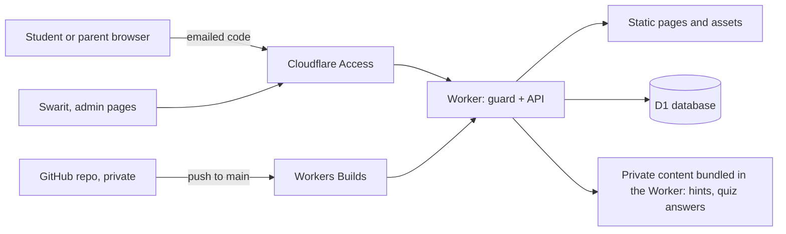
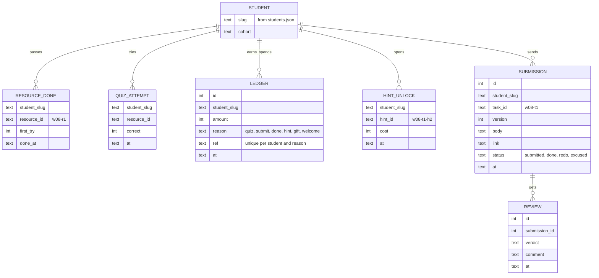

# Student platform PRD (draft v2.1)

_Version 2, 15 Oct 2026. Full PRD, because it touches children's data and payments-adjacent trust. Built on v1 (all of Swarit's decisions kept), restructured with the prd-writing, mvp-scoping, architecture-design, security-review and onboarding-flow skills. Items marked **Decide** need Swarit._

---

## 1. Summary

The course site becomes a guided student platform. Each week splits into short resources, each ending in a quick quiz, and the assignment splits into small tasks with hints. Students earn an in-site currency by learning and spend it on hints. They submit inside the site, Swarit reviews from one queue, and weeks publish themselves on the calendar.

Why it matters: one mentor teaches up to 20 children. The course only works if kids keep building between Sundays without being chased on WhatsApp.

## 2. Contacts

| Who | Role |
|---|---|
| Swarit Bhardwaj | Owner, teacher, reviewer. Approves the spec, the content and every push to `main` |
| Claude Code | Builds the platform, drafts the 12 weeks of content, runs tests and previews |
| Students (grades 6 to 12) | Primary users. Each signs in with their own email, given on the enrolment link. Contacted by email |
| Parents | Payers. Contacted on WhatsApp. They don't need their own sign-in; they can see progress on the child's screen or in Swarit's updates |
| Mentors (later) | Possible reviewers from the winter cohort. Not in v1 |

## 3. Background

**Today.** Week pages are static. The Submit button opens WhatsApp because the homework form is empty. Nothing records who did what.

**The problems this causes:**
- Swarit has to match WhatsApp files to children by hand.
- The teaching guide's own rule, "mark each Must task Done or Redo within 48 hours", can't be tracked.
- A child stuck on Tuesday waits until Sunday's class or the weekly 1:1.
- A whole assignment on one page is a lot for an 11-year-old. The guide already splits work into Must, Stretch and Bonus, but not into steps.
- Parents paid $600 and can't see progress without asking.

**Why now.** The founding cohort's week 1 opens on Monday 9 Nov 2026, and class one is Sunday 15 Nov. Changing the platform mid-cohort is risky, so it has to be ready before week 1.

**How others handle it** (well-known patterns, not researched in depth):

| Product | What it does well | Why it doesn't fit |
|---|---|---|
| Google Classroom | Free, assignments and grading | Needs a Google account per child, no hints, no rewards, no control over look |
| Thinkific, Skool | Courses, communities | $50 to $100 a month or a 10% cut, built for adults |
| Duolingo | Gems earned by learning, spent on extras | Proves the earn-and-spend loop works with kids |
| Khan Academy | Points, hints that cost mastery credit | Proves hints can carry a cost without stopping learning |
| Brilliant | Short lessons, each with a quick check | Proves "read a bit, answer a question" keeps attention |

Our version borrows the earn-and-spend loop, the quick checks and the small steps, inside a private site with one mentor reviewing real robot work.

## 4. Objective

**One objective:** enable every enrolled student to finish each week's Must tasks by the Saturday deadline without being chased, so that by week 11 every robot stands for 30 seconds and recovers from three taps.

**Primary metric:** share of Must tasks submitted by Saturday 8 PM ET. **Target: 80% or more in each of weeks 1 to 4.**

**Activation:** each student passes their first resource quiz before class one (by 15 Nov for the founding cohort). Target: 100%, since the cohort is small enough to follow up one by one.

**Guardrails** (must not get worse):
- 90% of submissions reviewed within 48 hours.
- Swarit's weekly platform work (reviews, extras, admin) stays under 3 hours for 10 students.
- Zero incidents of a student seeing another student's data, or a hint or answer before it is unlocked.
- Cost stays at $0 a month.

**North Star check:** quizzes and tasks build understanding; rewards keep kids working on the robot.

## 5. Market segments (by need)

| Segment | Their problem | Size |
|---|---|---|
| **Students at home with the kit, between Sundays** (primary) | "What do I do next?", "I'm stuck and class is days away", "Am I doing well?" | Founding: up to 10. Winter: up to 10 |
| **Parents** (secondary) | "Is the $600 working? Is my child keeping up?" without nagging the child | One or two per student |
| **Swarit** (internal) | "Who is stuck, who is behind, what needs my review?" across up to 20 kids, alone | 1 now, plus mentors later |

## 6. Value propositions

| Segment | Job | Pain removed | Gain |
|---|---|---|---|
| Student | Finish the week's build | Not knowing where to start; waiting days for help | One clear next step; hints on demand; visible progress and a balance that grows |
| Parent | Trust the course | Having to ask the child or Swarit | Same view as the child: check marks, feedback, milestones |
| Swarit | Teach and review 20 kids | Matching WhatsApp files; guessing who is stuck | One review queue, a roster sorted by "needs attention", weeks that publish themselves |

**Value curve** (H = high, M = medium, L = low):

| Factor | WhatsApp + Drive | Google Classroom | Sterling platform |
|---|---|---|---|
| Knows the next step | L | M | **H** |
| Help when stuck, any day | L | L | **H** (hints) |
| Motivation between classes | L | L | **H** (rewards, class board) |
| Review speed for Swarit | L | M | **H** |
| Privacy for minors | L | M | **H** |
| Monthly cost | $0 | $0 | **$0** |
| Setup per family | L | H (Google accounts) | **L** (emailed code) |

## 7. Solution

### 7.1 MVP hypothesis
We believe students will keep building between Sundays and submit Must tasks on time if each week is split into short resources with quick quizzes and small tasks with hints they can buy with points earned by learning. **We'll know we're right when 80% or more of Must tasks are submitted by Saturday 8 PM ET in weeks 1 to 4.**

### 7.2 First sign-in (first 5 minutes)
The aim is one small win before anything else.
1. Emailed code, then the site greets them by name: "Hi Aarav."
2. A three-line welcome card: "Read, answer, earn. Stuck? Spend on a hint. Submit your work here." Plus a **welcome gift of 10** in the currency, enough to try one hint.
3. The highlighted next step is the first resource of week 1 (about 5 minutes).
4. Quiz passed, so the balance rises with a small animation. First win done.
5. The welcome card never shows again.

### 7.3 The weekly loop
1. **Home.** This week at the top. One highlighted line with the next step. Week progress (resources 3 of 5, tasks 1 of 4). Balance in the header. Contents of all 12 weeks below.
2. **Week page.** The driving question, then Resources, then Tasks in order.
3. **Resource page.** An article with diagrams, a video, or both. Every resource ends with a **quick quiz of 2 or 3 questions, videos included**. No "Mark as done" button. Pass the quiz to earn and mark the resource done. A wrong answer shows "Look again at: [section]" and lets them retry.
4. **Task page.** What to do, the fill-in template with a copy button, hints, and the submit box.
5. **Hints.** Up to 3 per task: a nudge, then the approach, then nearly the answer. Each one costs. Once opened, a hint stays open. **All hints for a week become free once that week's solutions open** (the Saturday after class).
6. **Submit.** A text box (code is text, so `.ino` files paste straight in) and a link box (YouTube unlisted or Google Drive for videos and photos). The next task unlocks as soon as they submit.
7. **Feedback.** Swarit marks Done or Redo with a comment. Done pays out. Redo shows the comment and opens the submit box again.
8. **My progress.** Balance, week-by-week check marks, robot milestones, all feedback, and a short history of what they earned and spent.

### 7.4 Rewards economy
**Currency: Bolts** (decided 15 Oct).

**Values: decided 15 Oct** (welcome gift 10, retry pays 3). We start with these, watch weeks 1 and 2, then tune. They live in one settings file.

| Action | Amount |
|---|---|
| Welcome gift (once) | +10 |
| Resource quiz passed, first try | +5 |
| Resource quiz passed after a retry | +3 |
| Task submitted | +5 |
| Task marked Done | +10 |
| Stretch or Bonus task Done | +20 |
| Submitted before Saturday 8 PM ET | +5 |
| Hint 1, a nudge | -3 |
| Hint 2, the approach | -5 |
| Hint 3, nearly the answer | -8 |
| Gift from Swarit | any |

**What a normal week looks like** (5 resources, 4 tasks, all on time, all Done first try):

| Earned from | Bolts |
|---|---|
| 5 quizzes passed first try | 25 |
| 4 tasks submitted | 20 |
| 4 tasks Done | 40 |
| 4 on-time bonuses | 20 |
| **Total** | **about 105** |

All three hints on one task cost 3 + 5 + 8 = 16. So a strong week buys every hint on about six tasks. **Open:** if hints should feel like a real trade, raise them to 5 / 10 / 15 (30 for all three). That matches Swarit's first example ("earned 20, a hint costs 5").

Rules:
- Each resource and task pays out once.
- The balance never goes below zero.
- Rewards never affect Done or Redo.
- The ledger records the amount at the time, so changing a value later doesn't rewrite history.

### 7.5 Admin (Swarit)
- **Roster:** every student, current week, resources and tasks done, balance, last active, waiting reviews. Sorted by "needs attention": behind on Must tasks, inactive 3+ days, or Redo not resubmitted. Each flag shows days open ("inactive 4 days").
- **Review queue:** oldest first, with the hours waiting. Open a submission next to its task, choose Done or Redo, comment, next.
- **Student detail:** everything one student did, all feedback, ledger, gift button, "excuse this task" (for example when a kit arrives late).
- **Weekly extras form:** recording link, extra video, note to the class, class time, Meet link. Live at once, no push.
- **Class board:** full screen for Meet. First names only. Class milestones, check marks and this week's top three. Never the bottom, never hint spending, never emails or feedback.
- **Cohort switch:** founding or winter.

### 7.6 Content model and weekly publishing
```
content/weeks/week-08/
  index.md                    driving question, intro, order of resources and tasks
  resources/01-feedback-control.md   article or video; front matter: title, type, minutes, quiz
  tasks/01-fill-the-error.md         steps and template; front matter: kind (must/stretch/bonus)
  private/hints.md            hints per task; never copied to public files
  private/answers.md          quiz answers; never copied to public files
  solutions/                  opens the Saturday after class
  img/
```
**No weekly work for Swarit:**
1. Claude drafts all 12 weeks in this format from the teaching guide. Swarit reviews in a preview. One push before 9 Nov.
2. Weeks, solutions and free hints open on their dates by themselves.
3. Weekly extras go through the admin form, not code.
4. Fixes during the course are batched into one push a week at most.

Swarit's weekly job: teach, paste the recording link, review submissions.

**How releases work, and why not one branch per week.** Swarit's first idea was 12 branches (week 1 to week 12) and rebasing production onto each one weekly. Companies avoid that pattern:
- A fix to week 3 would need copying into every later branch, and they drift apart.
- Rebasing production rewrites its history, which breaks rollback and can lose work.
- Someone still has to do it every week, which is the work we want to remove.

The industry standard has two parts:
1. **One main branch.** Work happens on short-lived branches, gets checked and previewed, then merges into `main`. Every push to `main` deploys automatically (CI/CD). We already have this with Workers Builds.
2. **Deploying is separate from releasing.** Code and content go onto the server early, but stay hidden until a date or a switch turns them on. This is how streaming services upload a new episode days ahead and it appears at midnight, and how blogs and Shopify stores schedule posts and sales. In software it is called scheduled publishing, or a time-based feature flag.

For Sterling: all 12 weeks are deployed before 9 Nov, already sitting on the server. Each week is released on its date by the Worker checking the calendar on every request. Nobody touches Git on a Monday.

### 7.7 MVP scope (MoSCoW)

**Must have (v1, before 9 Nov)**

| Feature | Why it can't be cut | Risk | Effort |
|---|---|---|---|
| New content format + build (resources, tasks, private hints and answers) | Everything else sits on it | Med | M |
| Resource pages with quiz, server-checked | Decided by Swarit; earns the currency | Low | M |
| Currency ledger + welcome gift | The loop that drives the hypothesis | Med (integrity) | S |
| Tasks with tiered paid hints, free after solutions open | Core of "help when stuck" | Med (leaks) | M |
| Submit text + link, next task unlocks on submit | Replaces WhatsApp | Low | S |
| Review queue with Done / Redo + comment | Without it, submissions go nowhere | Low | S |
| Home "next step" + My progress | The minimal, focused view Swarit described | Low | M |
| Weekly extras form (recording link, notes, class time, Meet link) | The no-push weekly routine | Low | S |
| **Enrolment link** (decided 15 Oct): after admission, the family gets a private link. It collects the child's name, grade, cohort and the child's own email, plus a parent consent tick. Swarit approves it in admin, and the child is added to the class list and the sign-in list | Every child needs their own sign-in before 9 Nov, without Swarit editing files | Med (sign-in list update needs a Cloudflare API key) | M |
| **Delete a student's data** on withdrawal (decided 15 Oct): one admin button removes their records and their sign-in | Children's privacy, refund cases | Low | S |
| Security rules and tests (section 7.10) | Children's data | Med | M |
| Weeks 1 and 2 content in the new format | Students need something on 9 Nov | **High** (time) | L |

**Should have (v1.1, within 2 to 4 weeks of launch)**

| Feature | Trigger |
|---|---|
| Roster sorted by "needs attention" with days-open flags | Ships in week 1 if time allows, otherwise before week 3 |
| Class board for live classes | Before class 3 |
| Weeks 3 to 12 content | A week ahead of each week opening, all done by early December |

**Could have (v1.2+, if data supports it)**
Streaks, badges at robot milestones, file uploads, email notice when work is reviewed, certificate generated at the end, mentor reviewer accounts.

**Won't have (this cohort)**
Leaderboards that rank everyone (hurts the weakest kids), chat or forums (WhatsApp group already exists), browser editing of full lessons, third-party analytics (children's privacy), a phone app.

### 7.8 Architecture

**Pattern:** a modular monolith in the one Worker that already runs the site. One developer, one domain, free plan.



**Modules**

| Module | Job | Owns data | API |
|---|---|---|---|
| guard | Sign-in token check, enrolment, week and solution locks | none | runs before every request |
| content | Public week, resource and task pages built from Markdown | none (build output) | static files |
| private | Hints and quiz answers, bundled into the Worker at build | none (build output) | read only by learning |
| learning | Quizzes, hint purchases, submissions, progress | resource_done, quiz_attempts, hint_unlocks, submissions | `/api/...` |
| ledger | Currency balance and history | ledger | used by learning and admin |
| admin | Roster, reviews, extras, gifts, class board | reviews, week_extras, settings | `/api/admin/...` |

**Data model**


Also two small tables: `week_extras` (cohort, week, kind, value) and `settings` (key, value).

**API** (all behind the guard; identity always comes from the verified sign-in, never from the request)

| Method and path | Sends | Gets back |
|---|---|---|
| `GET /api/me` | | name, cohort, balance, next step, week progress |
| `GET /api/week/:n` | | resources and tasks with done, locked and unlocked-hint states |
| `POST /api/quiz` | resource_id, answers | pass or "look again at", amount earned, balance |
| `POST /api/hint` | hint_id | hint text, cost, balance (or "not enough") |
| `POST /api/submit` | task_id, body, link | status, amount earned, next task |
| `GET /api/admin/roster?cohort=` | | one row per student |
| `GET /api/admin/queue` | | waiting submissions, oldest first |
| `POST /api/admin/review` | submission_id, verdict, comment | saved |
| `POST /api/admin/gift` | student, amount, note | new balance |
| `POST /api/admin/extra` | cohort, week, kind, value | saved |
| `GET /api/admin/board?cohort=` | | first names, milestones, top three |

Errors: 401 not signed in, 403 not allowed, 404 unknown id, 409 already done or not enough balance, 422 bad input.

**Architecture decisions**

| # | Decision | Why | Alternatives that lost |
|---|---|---|---|
| ADR-1 | **D1** for progress data | SQL with transactions (hint purchase must check and spend in one step), free, sits on the same Worker, data stays in Cloudflare | KV (no transactions, slow to update everywhere); Supabase or Firebase (another vendor, another sign-in, children's data leaves Cloudflare) |
| ADR-2 | **Hints and quiz answers bundled inside the Worker**, never in public files | Nothing to leak by guessing a URL; no seeding step | A guarded file path (one guard bug leaks every answer); a D1 table (needs re-seeding each deploy) |
| ADR-3 | **Text + link submissions, no uploads** | No storage bill, no card on file, no hosting photos of children | R2 uploads (setup, cost, moderation of images of minors) |
| ADR-4 | **Lessons in Git Markdown; weekly extras in D1** | Swarit already writes Markdown with Claude; extras change weekly and must not cost a push | A full in-browser editor (large build, worse editing) |
| ADR-5 | **Roster stays in `students.json` for v1** | Works today, tested; Access list is manual anyway | Roster in D1 with Cloudflare API automation (v1.1) |
| ADR-6 | **No third-party analytics** | Children's privacy. Metrics come from our own tables | Google Analytics, PostHog |

**Cost:** $0 a month on Cloudflare's free plan (Workers, D1, Access). Check the current free limits before launch.

### 7.9 Edge cases
1. **Siblings.** Decided 15 Oct: every child signs in with their own email, given on the enrolment link. Parents don't sign in. Two siblings are two separate students.
2. **Late joiner in week 3.** Earlier weeks are open. The roster shows them as behind from day one. Swarit can excuse early tasks.
3. **Kit arrives late.** Kit tasks can't be done. Swarit marks them "excused" so they don't count against the student.
4. **Quiz guessing.** Retries are allowed but pay less (3 instead of 5), and each resource pays once. Guessing gains little.
5. **Resubmit after Done.** Allowed as a new version. No second payout.
6. **Not enough balance for a hint.** The button says how many more they need and how to earn them. After solutions open, hints are free anyway.
7. **Different time zones** (US coasts, Canada, Dubai). Deadlines are stored in ET and shown in the student's local time.
8. **Withdrawal and refund.** Decided 15 Oct: the child's data is deleted and their email comes off the sign-in list.
9. **Shared family laptop.** A visible "Sign out" link. Sign-in sessions expire.
10. **Reward values changed mid-week.** Past payouts stay as recorded. New values apply from then on.
11. **Admin is also testing as a student.** A separate test student account, flagged so it never appears on the class board.
12. **Sign-in seat limit.** Cloudflare Access is free for up to 50 users. With children only (no parent sign-ins), that is up to about 48 students across both cohorts. Remove founding students' access after demo day.
13. **Child under 13 gives an email.** US law (COPPA) treats a child's email as personal data. The enrolment link asks the parent to tick consent before the child's email is saved.

### 7.10 Security (STRIDE threat model)

| Threat | Type | What's at risk | Defence |
|---|---|---|---|
| Someone not enrolled signs in | Spoofing | Everything | Access emailed code at the edge; the Worker re-checks the token signature, issuer and expiry on every request (built, 27 tests) |
| A student calls the API as another student | Spoofing / privilege | Other students' work | Identity taken only from the verified token. No student id in any request. A test per endpoint |
| A student calls admin endpoints | Privilege | Reviews, gifts, roster | Admin check on the server for every `/api/admin` call |
| Editing requests to fake earnings | Tampering | Fairness of the economy | All amounts computed on the server. One payout per ref, enforced by a unique key. Hint purchase is one transaction |
| A form on another site posts as the student | Tampering | Submissions, balance | Origin check on every write; JSON only |
| Script typed into a submission | Tampering | Admin and parent views | Everything shown is escaped; strict content security policy |
| Reading hints or answers early | Disclosure | The point of the course | Bundled in the Worker, sent one at a time after unlock. Never in page source or public files |
| Guessing URLs for solutions | Disclosure | Answers | Date lock in the guard (built and tested) |
| Access to the code | Disclosure | Hints, answers, design | Private repo; no student GitHub access; no source maps |
| Preview links show real data | Disclosure | Children's data | Previews never bind the real database; sample data only |
| Notes about minors in logs | Disclosure | Privacy | Logs never record submission text, comments or emails |
| Who changed what | Repudiation | Disputes over reviews | Reviews and gifts stored with time and reviewer; ledger is append-only |
| Flooding quizzes or submissions | Denial of service | Free-plan limits | Per-student rate limit on writes |
| Data loss | | Progress records | D1 point-in-time restore; weekly export |
| Children under 13 | Legal | Compliance | Collect the least data; parent consent at admission on the terms page; delete on request. US law (COPPA) applies. **Check with a lawyer**; this is not legal advice |

Before launch: run a dependency audit and a review of every endpoint with the `security-review` skill.

### 7.11 Assumptions

| # | Assumption | Evidence | Would be wrong if |
|---|---|---|---|
| 1 | Kids will care about earning and spending points | Duolingo, Khan Academy and classroom reward systems | In weeks 1 and 2, fewer than half the students open any hint or check their balance |
| 2 | Weeks 1 and 2 can be drafted and approved by 8 Nov | The teaching guide already holds the material; Claude drafts, Swarit reviews | Reviewing the week 1 sample takes Swarit more than a day |
| 3 | Children sign in themselves with their own email | Grade 6 to 12 students usually have school or personal email | Parents end up doing it for them, so the activity data is really the parent's |

### 7.12 Out of scope (v1)
File uploads, mentor accounts, email or WhatsApp notices, streaks, badges, certificates, editing full lessons in the browser, parent sign-ins, leaderboards that rank everyone, chat, a phone app, third-party analytics.

## 8. Release

The cohort dates are fixed, so this plan uses real dates.

| Phase | When | What | Exit check |
|---|---|---|---|
| 0. Spec | by 18 Oct | PRD agreed; week 1 rewritten in the new format as the sample | Swarit approves the sample |
| 1. Build | 19 to 29 Oct | `feature/student-platform` off `redesign`; all tests green; local previews | Every Must feature works in a local preview, security tests pass |
| 2. Content | 19 Oct to 4 Nov, in parallel | Weeks 1 and 2 final; weeks 3 to 12 drafted | Swarit approves weeks 1 and 2 |
| 3. Dogfood | 30 Oct to 4 Nov | Swarit plus one test student use it end to end (and a friendly child, if available) | No blocking bugs; Swarit finishes a review in under 2 minutes |
| 4. Launch | push by 6 Nov | Merge `redesign` + platform into `main`, one push | Week 1 opens by itself on 9 Nov |
| 5. Check | after week 2 (about 29 Nov) | Tune reward values; ship class board and roster sorting | Activation and on-time rates read |
| 6. Hypothesis | after week 4 (about 13 Dec) | Is the on-time Must rate 80% or more? | Keep, adjust, or simplify |

**Feature switch:** one setting turns the platform off and shows the plain notebook pages, with Submit back on WhatsApp.
**Roll back if:** a student sees another student's data or an unlocked answer, or students can't submit for more than 12 hours. Flip the switch, fix on a branch, push again.

## 9. Decisions

| # | Question | Status |
|---|---|---|
| 1 | Quiz to finish every resource, videos too | **Decided** (15 Oct) |
| 2 | Submissions inside the site | **Decided** (15 Oct) |
| 3 | Class board that never ranks the bottom | **Decided** (15 Oct), $0 cost |
| 4 | Hints free once solutions open | **Decided** (15 Oct) |
| 5 | Weekly publishing automated | **Decided** (15 Oct). How it works: end of 7.6 |
| 6 | Currency name | **Decided: Bolts** (15 Oct) |
| 7 | Starting values in 7.4, welcome gift 10, retry pays 3 | **Decided** (15 Oct) |
| 8 | Siblings | **Decided:** each child has their own email via the enrolment link; parents on WhatsApp, children by email (15 Oct) |
| 9 | Delete a child's data on withdrawal | **Decided: yes** (15 Oct) |
| 10 | Hint prices 3 / 5 / 8, or 5 / 10 / 15 | **Open** (new). Recommendation: 5 / 10 / 15 |

## Change log
- v0 (15 Oct): first draft from Swarit's vision.
- v1 (15 Oct): Swarit's answers; quiz for every resource; publishing without weekly work.
- v2 (15 Oct): rebuilt as a full PRD with the installed skills. Added: one objective and metrics, segments and value curve, MVP hypothesis and MoSCoW cut, first-sign-in plan with welcome gift, architecture (modules, data model, API, six decisions), 12 edge cases (siblings, late kits, Access seat limit), STRIDE security table, assumptions, release phases with rollback. Retry pays 3.
- v2.1 (15 Oct): Bolts; values and welcome gift confirmed; children sign in with their own email from an enrolment link (now a Must); parents on WhatsApp; delete data on withdrawal; how releases work (deploy vs release); a sample week of earnings and the open hint-price question.
