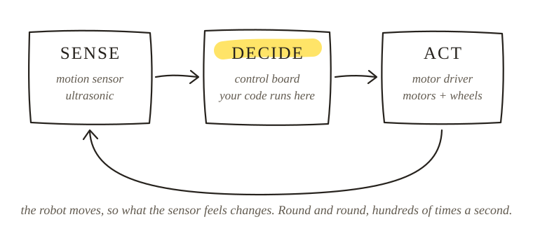

> What does each part of the robot do in the sense, decide, act loop?



## By the end of this week
- A built robot you have seen balance
- A 10-second video of it balancing
- The proof that ==power off means it falls==, so the code does the balancing
- A working upload from Arduino IDE

## Have ready for class
- Kit unboxed and checked, battery charged
- A clear table, the screwdriver from the kit, a small bowl for screws
- Phone joined to the call as a second camera pointing at your hands, muted
- Laptop with Arduino IDE 2 installed and a USB cable that carries data

## Assignment

### Must: Build photos
Front, side and top photos. Whole robot in frame, good light.

### Must: Demo video
10 seconds of the robot balancing on Elegoo's demo, recorded in class. If you missed it, re-upload Elegoo's code from the resource pack and record it.

### Must: Label the robot
For each part, say which job it does in the loop and what you think it does.

```
LABEL THE ROBOT
Part           | Sense / Decide / Act / Power | What I think it does
Control board  |                              |
Motion sensor  |                              |
Motor driver   |                              |
Motors         |                              |
Battery        |                              |
Ultrasonic     |                              |
```

### Must: Upload proof
Screenshot of "Done uploading" in Arduino IDE.

### Stretch: Fall test
Power off, stand the robot upright and let go five times while filming in slow motion. Estimate how long each fall takes. Compare with the broom from week 1.

## Before you submit, check
- Photos show wires clear of the wheels and no loose plates
- Every row of the label table has a guess
- Upload screenshot shows "Done uploading"

## Resources
- Elegoo Tumbller manual and code pack
- Recorded build video (if your kit arrived late)
- Hello sketch
